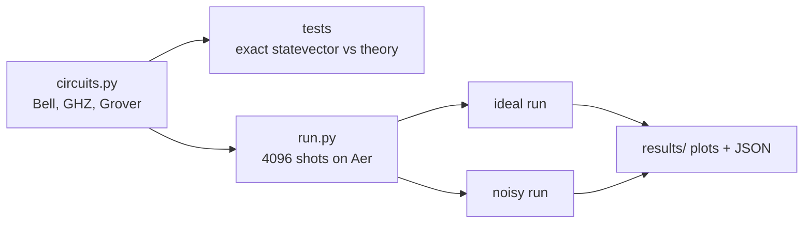
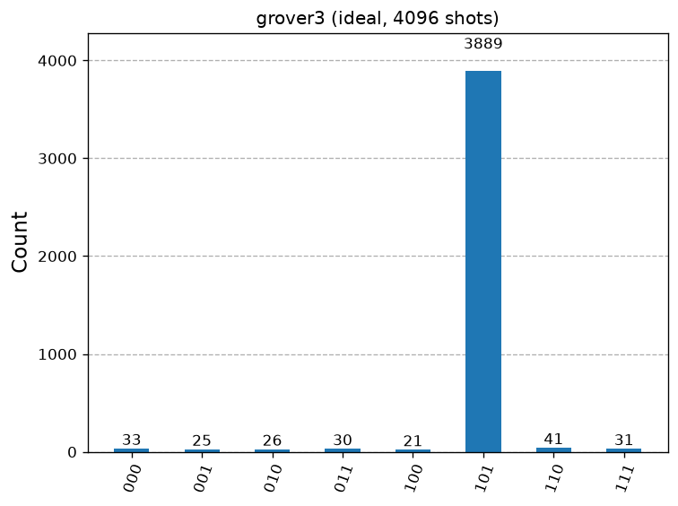

# 01 · Qiskit first steps: Bell, GHZ and Grover

[](https://github.com/Madmaxcoder2612/qiskit-bell-ghz-grover/actions/workflows/ci.yml)
[](https://www.python.org/downloads/)
[](LICENSE)
[](#limitations)

Three small quantum circuits built in [Qiskit](https://www.ibm.com/quantum/qiskit), checked against theory with tests, and run on a simulator with and without a simple noise model. It is a first project for learning the basics: superposition, entanglement and amplitude amplification.

> **Disclaimer:** everything here runs on a simulator. The noise model uses illustrative error rates, not values calibrated to any real IBM device. Nothing in this repo has been run on quantum hardware yet.

## Contents

- [Results at a glance](#results-at-a-glance)
- [Quick start](#quick-start)
- [How it works](#how-it-works)
- [Repository layout](#repository-layout)
- [Limitations](#limitations)
- [Next steps](#next-steps)



## Results at a glance

Probability of measuring the expected outcome(s), 4096 shots, seed 42:

| Circuit | Expected outcomes | Ideal | Noisy (illustrative) |
|---|---|---|---|
| Bell pair (2 qubits) | `00`, `11` | 1.000 | 0.994 |
| GHZ (3 qubits) | `000`, `111` | 1.000 | 0.988 |
| Grover (3 qubits, marked `101`, 2 iterations) | `101` | 0.949 | 0.774 |

Theory for Grover with 8 items and 2 iterations is sin²(5·asin(1/√8)) ≈ 0.945. The 0.949 is shot noise around that value. The noisy run shows why deeper circuits suffer more: Grover has many more two-qubit gates than Bell.



## Quick start

```powershell
git clone https://github.com/Madmaxcoder2612/qiskit-bell-ghz-grover
cd qiskit-bell-ghz-grover
python -m venv .venv
.\.venv\Scripts\Activate.ps1
pip install -e ".[test]"
pytest -q
python -m qfirst.run            # ideal simulator
python -m qfirst.run --noisy    # with depolarizing noise
```

Plots and `summary_*.json` land in `results/`.

## How it works

| File | What it does |
|---|---|
| `src/qfirst/circuits.py` | Builds the Bell, GHZ and Grover circuits (oracle and diffuser are separate functions) |
| `src/qfirst/run.py` | Transpiles and runs on `AerSimulator`, saves histograms, circuit drawings and JSON |
| `tests/test_circuits.py` | Compares exact statevector probabilities with theory, including edge cases and bad input |
| `.github/workflows/ci.yml` | Runs tests and both simulations on Python 3.10 and 3.12 |

Qiskit bit order is little-endian: in the string `101`, the rightmost bit is qubit 0.

## Repository layout

```
01-qiskit-bell-ghz-grover/
├── src/qfirst/        circuits and runner
├── tests/             pytest suite (12 tests)
├── results/           generated plots and JSON
├── .github/workflows/ CI
└── pyproject.toml
```

## Limitations

- Simulator only. Real devices have connectivity limits, readout errors and calibration drift that are not modelled.
- Noise rates (0.1% single-qubit, 1% two-qubit depolarizing) are made-up round numbers for illustration.
- Grover is tested for one marked item and 2 to 3 qubits only.
- Results are single runs with a fixed seed, with no repeated-run statistics.

## Next steps

1. Run the same circuits on real IBM hardware through the free Open Plan and compare to the simulator.
2. Add error mitigation and measure what it recovers.
3. Quantum teleportation and the Deutsch–Jozsa algorithm.
4. Later: a quantum-related functional safety angle, such as how to reason about faults and reliability in noisy computation.

## License

MIT, see [LICENSE](LICENSE).
